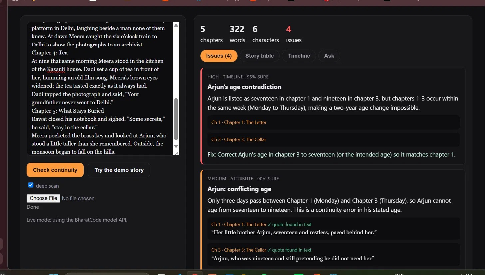

# Sutradhar · सूत्रधार



**The narrator who never forgets.** A continuity editor for fiction writers, powered by the [BharatCode](https://bharatcode.ai) model API.

Long stories lie to themselves. Eyes change colour between chapter 1 and chapter 12. A grandmother dies in chapter 2 and pours tea in chapter 4. A character is on a train to Delhi at six and back home by nine. Human editors catch these on the third read; Sutradhar catches them on the first.

> Built for the BharatCode Build League · category: *Writing & creative work*

## What it does

1. **Builds a story bible.** Splits your manuscript into chapters and extracts characters, aliases, facts (eyes, hair, age, relationships…), who is alive, and a timeline of events.
2. **Finds contradictions.** Deterministic checks flag suspicious spots (a fact that changes, a dead character who acts later). The model then judges each one, so flashbacks, dye jobs and time passing aren't false alarms.
3. **Deep scan.** A second pass looks at the timeline for impossible travel, knowledge leaks and location changes.
4. **Shows its evidence.** Every issue quotes the text, and every quote is **checked against your manuscript**. If the model invents a quote it is marked `⚠ quote not found`.
5. **Answers questions.** "When does Dadi die?" "What does the key open?" Answers cite chapters.

## Try it in 10 seconds (no API key)

```bash
git clone https://github.com/aastha-m22/sutradhar && cd sutradhar
python -m sutradhar serve        # open http://127.0.0.1:8000 and press "Try the demo story"
python -m sutradhar check --demo # or in the terminal
```

Demo mode runs the *real* pipeline on a bundled short mystery ([examples/the_cellar_key.md](examples/the_cellar_key.md)) with three planted errors, using a scripted stand-in for the model, so you can see exactly what the tool produces.

## Use it on your own story

```bash
export BHARATCODE_API_KEY=...          # get one at https://bharatcode.ai (free for students)
python -m sutradhar check mynovel.md --md report.md
python -m sutradhar ask "Where was Arjun on Thursday?" mynovel.md
python -m sutradhar serve              # web UI with live mode
```

Chapters are detected from headings (`## Chapter 3`, `Chapter Three`, `# Title`); plain text is chunked automatically. No dependencies beyond the Python standard library (3.9+).

## How it works

```
manuscript ─► chapters ─► per-chapter extraction (BharatCode model, parallel)
                               │
                       merge into story bible (alias resolution)
                               │
              candidate detection (changed facts, posthumous appearances)
                               │
          model verification (real error vs. innocent explanation)  ──► deep timeline scan
                               │
              quote verification against the original text
                               │
                     issues + bible + timeline + Q&A
```

| File | Role |
|---|---|
| `sutradhar/llm.py` | OpenAI-compatible client for `https://bharatcode.ai/api/model/v1` (default model `qwen-3.8-27b`) |
| `sutradhar/pipeline.py` | extraction → verification → scan → quote checks |
| `sutradhar/bible.py` | story bible merge + candidate detection |
| `sutradhar/server.py`, `web/index.html` | web app (stdlib server, no build step) |
| `sutradhar/demo.py` | offline scripted model for the demo |

Set `BHARATCODE_MODEL=deepseek-v4.1-flash` to use the other model.

## Run the tests

```bash
pip install pytest && pytest
```

## Deploy

`Dockerfile` included (`docker build -t sutradhar . && docker run -p 8000:8000 -e BHARATCODE_API_KEY=... sutradhar`). Without a key the hosted app still offers the demo.

## Roadmap

- Tracking objects and injuries (the sword that was lost, the arm that was broken)
- Multi-book series bibles
- Export the bible to Scrivener / Obsidian
- Indian-language manuscripts (Hindi, Tamil, Bengali…)

MIT licensed. Made by [Aastha Mahajan](https://github.com/aastha-m22).
